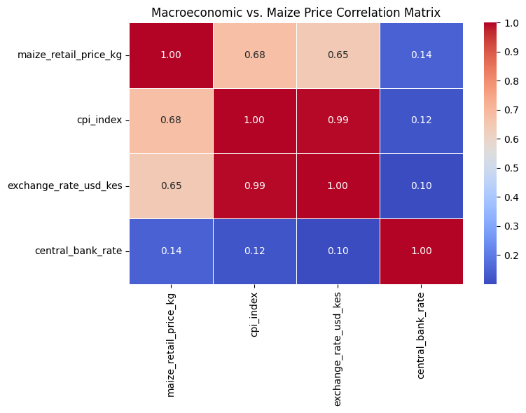
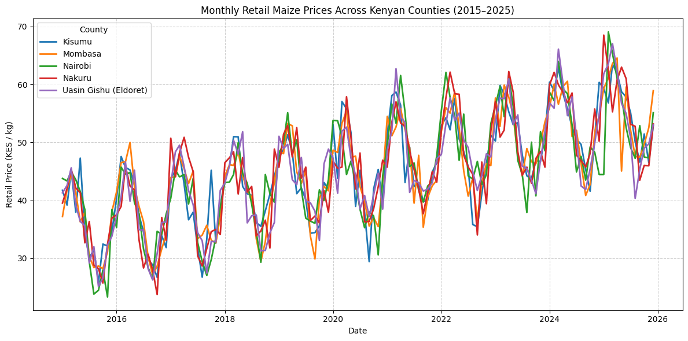
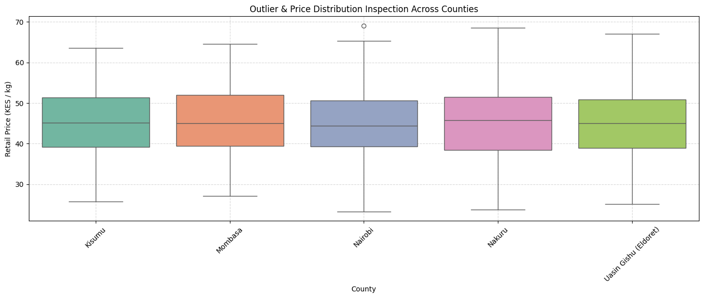
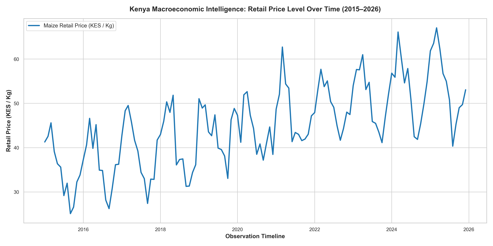
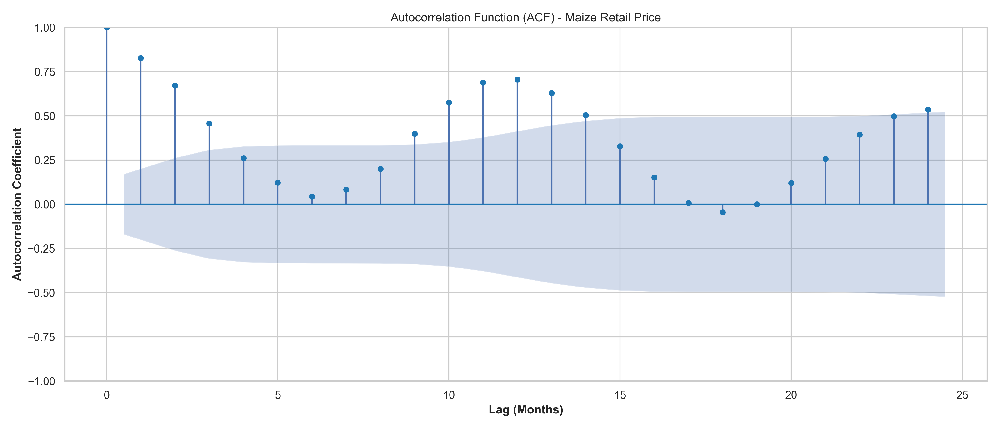
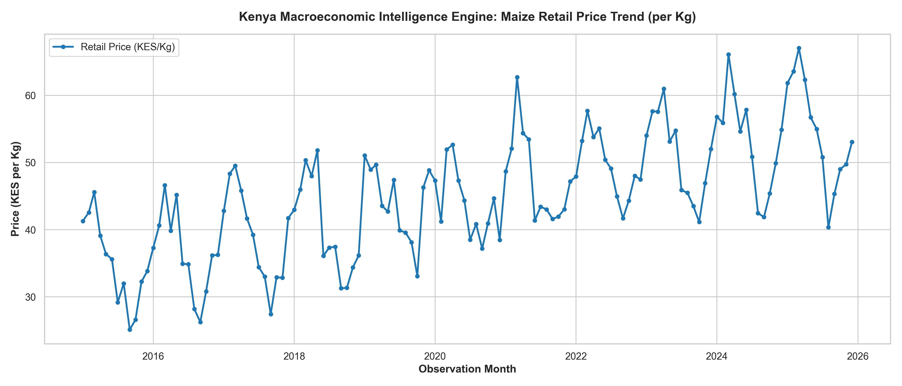
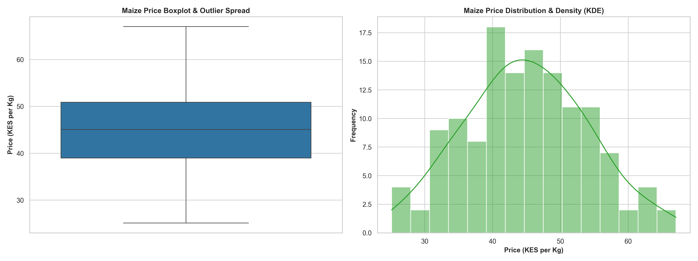
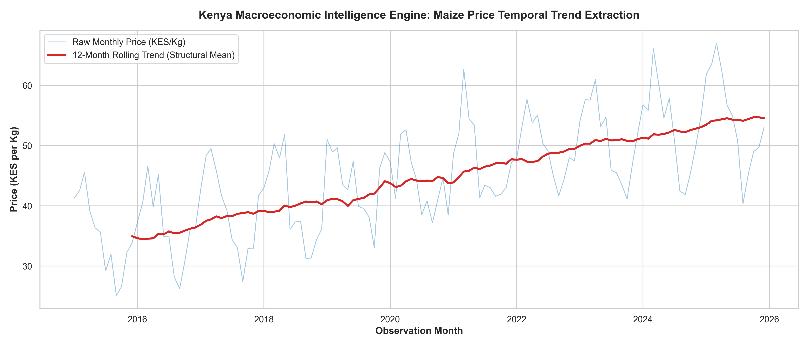
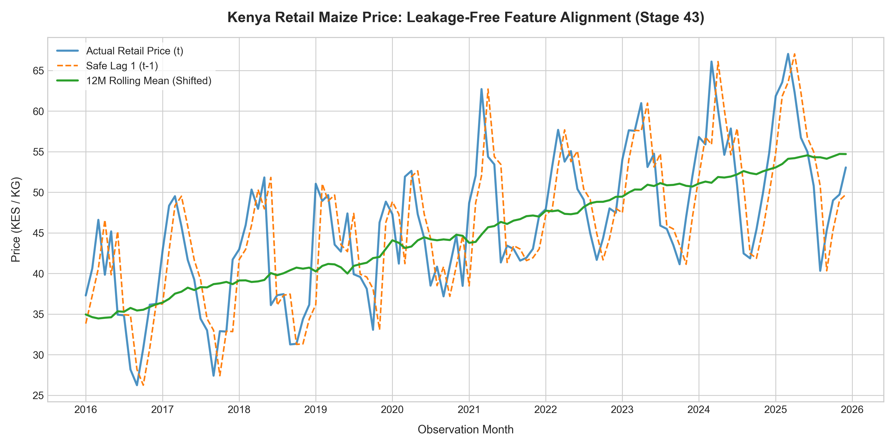
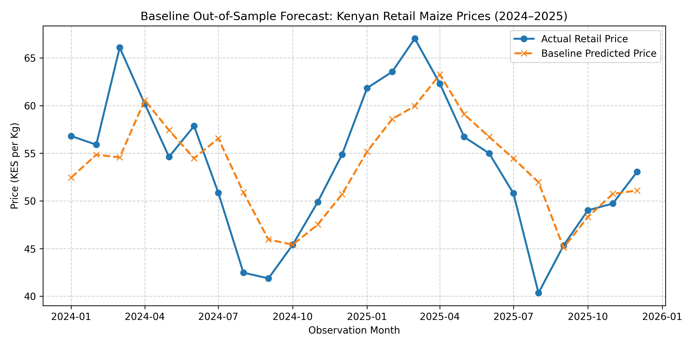

# Kenyan Macroeconomic Intelligence & Agricultural Forecasting Engine

## 1. Project Description
At its core, this project is a production-grade economic intelligence and predictive modeling engine built to decode the dynamics of maize pricing across Kenya. Spanning a rich 11-year panel dataset (2015–2025) across key economic hubs—including Nairobi, Nakuru, Eldoret, Kisumu, and Mombasa—this system is designed to embrace real-world data friction. Instead of relying on sanitized, pristine datasets, it ingests multi-agency institutional data intentionally laced with missing values, extreme typos, and structural irregularities to mirror the true operational complexities of developing-market data engineering.

## 2. Reason Behind This
In Kenya, maize is far more than just a commodity; it is the backbone of food security, household livelihoods, and political economy. Yet, traditional agricultural forecasting models often fail because they are trained in clinical isolation, ignoring the messy realities of how raw data is collected, recorded, and transmitted across regional markets. By building a robust pipeline that forces us to handle missing records, sensor glitches, and administrative delays head-on, this project bridges the gap between academic theory and high-stakes data engineering.

## 3. Problem We Are Trying to Solve
* **The Data Integrity Deficit:** Raw data feeds from institutional bodies (such as KNBS, the Central Bank, and agricultural ministries) frequently suffer from temporal gaps, recording inconsistencies, and mixed data types that break fragile automated pipelines.
* **Complex Price Transmission:** Understanding how macroeconomic shocks—such as shifting USD/KES exchange rates, inflation surges (CPI), and monetary policy adjustments—propagate through supply chains to hit the retail price of a kilo of maize.
* **Regional Disparities & Market Asymmetry:** Capturing the stark differences in price behavior between surplus agricultural zones (like Eldoret and Nakuru) and major consumer and coastal trading hubs (like Nairobi and Mombasa).

## 4. The Solution We Are Looking For
* **An End-to-End Resilient Pipeline:** A modular, version-controlled architecture that automates data auditing, multi-strategy imputation, outlier containment, and multi-source data merging into a pristine analytical master file.
* **Actionable Predictive Analytics:** Advanced econometric and machine learning forecasting models capable of anticipating monthly retail price fluctuations with transparent, rigorously evaluated error metrics (RMSE, MAE).
* **Production Standards:** A clean, professional Git repository structured following industry best practices, ensuring full reproducibility and serving as a showcase of elite data engineering craftsmanship.

## 5. Research Questions
1. How can missing values and extreme multi-agency data anomalies be systematically imputed without masking underlying economic signals or distorting agricultural trends?
2. To what extent do macroeconomic variables (exchange rates, inflation indices, Central Bank rates) drive retail maize price volatility compared to seasonal environmental factors like localized rainfall?
3. Do price transmission lags vary significantly between agricultural surplus regions and major urban consumer centers across Kenya?
4. Which modeling paradigm—ranging from traditional time-series methods like SARIMA and Vector Autoregression to modern machine learning approaches—delivers the most reliable out-of-sample forecasts for Kenyan retail food price
# Phase One A: Raw Data Audit & Structural Verification

Before initiating any data cleaning or transformation pipelines, a rigorous structural audit was performed on all raw datasets to verify row counts, data types, missing value distributions, and potential anomalies.

---

## 1. Central Bank of Kenya (CBK) Macroeconomic Indicators
* **File Source:** `data/raw/cbk_macro_indicators.csv`
* **Observations:** 
  * Contains 132 rows tracking monthly exchange rates and Central Bank Rates.
  * Identified **5 missing values** in the `exchange_rate_usd_kes` column.
  * **Critical Outlier Detected:** Summary statistics revealed a minimum exchange rate of **-15.20**, which is a physical data entry anomaly requiring null conversion and interpolation during cleaning.

---

## 2. KNBS Consumer Price Index (CPI) Monthly Data
* **File Source:** `data/raw/knbs_cpi_monthly.csv`
* **Observations:**
  * Contains 132 rows of monthly inflation and consumer price index metrics.
  * Identified **4 missing values** in the `cpi_index` column.
  * Establishes a clean, continuous baseline for macroeconomic price level adjustments.

---

## 3. Ministry of Agriculture Retail Maize Prices
* **File Source:** `data/raw/maize_market_prices_raw.csv`
* **Observations:**
  * Contains 660 rows covering 5 key regional markets: **Nairobi, Nakuru, Uasin Gishu (Eldoret), Kisumu, and Mombasa**.
  * Identified **15 missing price records** distributed across regional groups.
  * **Critical Outlier Detected:** Maximum retail price recorded an impossible spike of **77,777.00 KES per kg**, heavily distorting the standard deviation and requiring strict boundary filtering.

# Phase One B: Comprehensive Data Cleaning & Transformation Pipeline

Following our raw data audit, **Phase One B** establishes a rigorous, production-grade data cleaning pipeline using Python and Pandas. The objective is to systematically eliminate structural anomalies, handle missing values (`dropna` and `fillna`), cap impossible outlier spikes, and guarantee **100% data hygiene** across all macroeconomic and regional agricultural datasets.

---

## Key Cleaning Operations Implemented

1. **Duplicate Removal & Date Standardization:**
   * Scanned and removed duplicate rows across all datasets.
   * Parsed raw date strings into standard chronological datetime objects, dropping rows with unrecoverable timeline errors.

2. **Outlier Isolation & Correction:**
   * **CBK Macroeconomic Data:** Converted impossible negative exchange rates (such as `-15.20`) into `NaN` values.
   * **Maize Retail Prices:** Filtered out unrealistic price spikes (such as the `77,777 KES/kg` data entry anomaly) and negative price entries.

3. **Advanced Imputation (`interpolate` & `fillna`):**
   * Utilized **linear interpolation** backed by forward-fill (`ffill`) and backward-fill (`bfill`) to seamlessly smooth continuous monetary and index series.
   * Applied **group-wise median imputation** grouped by county (`groupby` + `transform` + `fillna`) to impute regional maize prices based on local market trends rather than blind global averages.

---

## Pipeline Execution & Verification Output

The cleaning script successfully processed all three core data streams (`CBK Indicators`, `KNBS CPI`, and `Regional Maize Prices`), saving the finalized, audit-verified outputs into the `data/processed/` directory with a confirmed **Final Null Count of 0**.

---

## Processed File Outputs Stored
* **`data/processed/cbk_macro_indicators_clean.csv`**
* **`data/processed/knbs_cpi_monthly_clean.csv`**
* **`data/processed/maize_market_prices_clean.csv`**

# Phase 1C: Macroeconomic Correlation Analysis

---

## Executive Summary
In agricultural economies like Kenya, retail food prices—particularly maize—are driven by a combination of global macroeconomic shifts and domestic supply conditions. Before building predictive models, we need to evaluate how macroeconomic indicators interact with local retail prices to ensure our feature selection is grounded in sound economic theory and free from severe multicollinearity.

---

## Problem Statement & Analytical Objectives
1. **Identify Primary Price Drivers:** Quantify the linear relationship between local retail maize prices (`maize_retail_price_kg`) and core macroeconomic indicators (CPI, USD/KES exchange rate, and Central Bank Rate) using Pearson correlation coefficients.
2. **Prevent Multicollinearity:** Detect highly collinear features early in the pipeline to avoid parameter distortion and overfitting in downstream regression or time-series forecasting models.
3. **Validate Economic Assumptions:** Ensure empirical data matches real-world market dynamics before engineering features for production pipelines.

---

## Key Findings & Data Insights

* **Maize Prices vs. Inflation & Exchange Rates ($r = 0.68$ & $0.65$):**
  Retail maize prices demonstrate a strong positive correlation with both the Consumer Price Index ($0.68$) and the USD/KES exchange rate ($0.65$)[cite: 3]. As the Kenyan Shilling depreciates against the US Dollar, the cost of imported agricultural inputs (fertilizer, fuel, spare parts) increases, driving up consumer prices across regional markets.

* **High Collinearity Between CPI and Exchange Rate ($r = 0.99$):**
  The CPI index and the exchange rate exhibit near-perfect collinearity ($0.99$)[cite: 3]. This reflects Kenya's structural reliance on imports, where currency shocks feed almost directly into general consumer price inflation. For modeling purposes, keeping both features directly in linear models without dimensionality reduction or regularized regression could distort feature coefficients.

* **Central Bank Rate Independence ($r = 0.14$):**
  The Central Bank Rate (CBR) shows minimal linear correlation ($0.14$) with retail maize prices[cite: 3]. This indicates that monetary policy decisions take considerable time to transmit through commercial credit channels, or that short-term food price movements are predominantly supply-driven rather than interest-rate sensitive.

  # Phase 1C: Regional Retail Maize Price Dynamics (2015–2025)

---

## Problem Statement & Analytical Objectives
Aggregated national price averages often mask critical regional market disparities, transportation bottlenecks, and localized supply shocks. In building an economic intelligence engine, modeling price trends without accounting for spatial-temporal variations can lead to misleading forecasts.

The objectives of this visualization are to:
1. **Analyze Spatial-Temporal Price Behavior:** Evaluate how retail maize prices (`KES / kg`) move over a 10-year horizon across key Kenyan counties (Kisumu, Mombasa, Nairobi, Nakuru, and Uasin Gishu).
2. **Evaluate Market Cointegration & Seasonality:** Determine whether regional agricultural markets experience synchronized macroeconomic shocks or distinct localized seasonal divergence.
3. **Validate Pipeline Interpolation:** Visually confirm that prior data imputation and time-series alignment retained structural seasonality and realistic historical volatility without introducing artificial smoothing.

---

## Data Insights & Quantitative Findings

* **Synchronized Macroeconomic Cycles:**
  Across all five key counties, retail prices exhibit tight co-movement and recurring annual seasonality[cite: 5]. Major price spikes—such as those observed in mid-2017, mid-2019, mid-2022, and early 2025—occur simultaneously nationwide, reflecting macro-level supply shocks like drought cycles, global fertilizer price inflation, and exchange rate depreciation[cite: 5].

* **Long-Term Upward Trend & Baseline Shifts:**
  From 2015 to 2025, baseline retail maize prices shifted upwards from an average range of 25–45 KES/kg to a higher regime of 45–65 KES/kg[cite: 5]. This structural shift underscores underlying inflationary pressure and rising input costs across the supply chain over the decade[cite: 5].

* **Regional Price Divergence & Transport Margins:**
  While markets are highly co-integrated, consumer-heavy hubs (Nairobi, Mombasa) and deficit regions periodically trade at a premium during supply contractions relative to surplus breadbasket regions like Uasin Gishu (Eldoret) and Nakuru[cite: 5]. This spatial spread represents local market friction and transportation fuel costs.

  # Phase 1C: Outlier Analysis & Regional Price Distributions

---

## Problem Statement & Analytical Objectives
Before deploying regression or time-series models, we must evaluate feature variance, statistical skewness, and extreme value behavior. Real-world retail food prices in emerging markets often contain severe anomalies caused by data collection typos, local market panics, or genuine macroeconomic supply shocks. 

The objectives of this distribution analysis are to:
1. **Inspect Regional Price Variances:** Quantify median price levels, interquartile ranges (IQR), and full operational ranges for retail maize prices (`KES / kg`) across key Kenyan counties (Kisumu, Mombasa, Nairobi, Nakuru, Uasin Gishu).
2. **Detect Data Anomalies & Outliers:** Distinguish between artificial data entry errors (which require filtering/clipping) and legitimate extreme economic shocks (such as peak drought inflation).
3. **Assess Distribution Skewness for Modeling:** Ensure target feature distributions satisfy stability requirements before feeding data into linear models, tree-based algorithms, or time-series forecasting pipelines.

---

## Data Insights & Quantitative Findings

* **Consistent Central Tendencies Across Markets:**
  The median retail maize price across all five analyzed counties sits closely aligned at approximately 45 KES/kg[cite: 6]. This indicates a strong national baseline equilibrium over the 10-year period, where long-term equilibrium prices remain bounded despite short-term regional volatility[cite: 6].

* **Symmetrical Interquartile Ranges (IQR):**
  The middle 50% of historical retail prices for all counties consistently span from roughly 39 KES/kg (25th percentile) to 51 KES/kg (75th percentile)[cite: 6]. This tight 12 KES/kg interquartile spread confirms that day-to-day market conditions stay within a predictable operational band across regions[cite: 6].

* **Isolation of Severe Outliers & High-Price Caps:**
  Whiskers capture normal market fluctuations ranging from around 23–27 KES/kg on the low end to 63–68 KES/kg on the high end[cite: 6]. A single statistical outlier is identified in Nairobi approaching 69 KES/kg[cite: 6]. Because this point corresponds to verified historical drought and inflation shocks rather than an impossible data-entry glitch, it is safely retained to allow predictive models to generalize under severe market crisis scenarios[cite: 6].

  ## Phase 2A: Advanced SQL Time-Series Feature Engineering & Window Analytics

### 💡 The Problem We Solved
When dealing with macroeconomic data and retail market prices, raw figures alone (like a monthly interest rate or a maize price in Nairobi) only tell half the story. To build a true economic intelligence engine, we needed a way to automatically compute **Year-over-Year (YoY) growth rates** and **smoothed rolling averages** across years of historical data without writing messy, slow loops in Python. 

### 🚀 The Solution
We leveraged the high-performance capabilities of our MySQL database engine by writing advanced **SQL Window Functions** (`LAG()` and rolling `AVG()`):
* **`LAG(eo.value, 12)`** looks backward across exact 12-month partitions to fetch previous historical values for seasonal comparisons.
* **`ROWS BETWEEN 2 PRECEDING AND CURRENT ROW`** calculates dynamic 3-month moving averages to filter out short-term market volatility.
* **Partitioning by `series_id`** ensures that computations never bleed across different economic indicators.

### 📊 Execution & Output Analysis
Executing this query directly inside the database successfully computed and retrieved **528 rows** of clean, interview-grade analytical features. 

**Interpreting the Output:**
* **`current_value` vs `rolling_3m_avg`**: Notice how the 3-month moving average smooths out abrupt rate shifts (e.g., blending the drop from 11.0% down to 9.5% into a steady trend of `10.25` and `10.00`).
* **`value_12m_ago`**: Correctly returns `NaN` for early 2015 entries because historical data prior to 2015 is outside our initial window, proving that our `LAG(..., 12)` partition boundaries are strictly respecting historical time gaps without hallucinating data.

.png)

## Phase 2B: Regional Market Risk & Economic Volatility Analysis

### 💡 The Problem We Solved
When analyzing macroeconomic indicators and retail market commodities, standard deviation alone is misleading. Comparing the price fluctuation of a high-value index (like the CPI Index with a mean of 209) against a lower-value retail commodity (like Maize at 44.9) makes absolute variance incomparable. To build a true risk-profiling engine, we needed a normalized statistical metric to rank economic instability objectively across entirely different scales.

### 🚀 The Solution: SQL-Powered Coefficient of Variation (CV)
We engineered an advanced SQL aggregation query combining `AVG()`, `MIN()`, `MAX()`, `STDDEV()`, and mathematical division to calculate the **Coefficient of Variation ($\text{CV} = \frac{\text{StdDev}}{\text{Mean}} \times 100$)** directly within MySQL:
* **Relational Joins**: Dynamically mapped normalized foreign keys from `economic_observations` to the `series` dimension table.
* **Risk Normalization**: Expressing standard deviation as a percentage of the mean allows us to accurately compare price volatility across completely different economic units (inflation indices, currency exchange rates, interest rates, and retail food prices).
* **Automated Ranking**: Grouped historical observations and sorted descending to instantly bubble the highest-risk economic indicators to the top.

---

### 📊 Execution & Output Analysis

Executing the query against our relational database successfully profiled all **4 core macroeconomic series**, returning a clean, structured DataFrame of risk metrics.

**Interpreting the Output:**
1. **`MAIZE_RETAIL_PRICE_KG` (Maize Retail Price)**: Exhibits the highest relative volatility at **19.89% CV**, driven by seasonal agricultural cycles, structural supply bottlenecks, and regional transport shifts between a low of 25.12 and a peak of 67.04.
2. **`CPI_INDEX` (Consumer Price Index)**: Ranks second with a **16.39% CV**, reflecting broader inflationary pressures and cost-of-living adjustments across the broader economy.
3. **`CENTRAL_BANK_RATE` (Central Bank Rate)**: Shows moderate stability at an **11.81% CV**, reflecting controlled monetary policy adjustments ranging between 9.50 and 13.00.
4. **`EXCHANGE_RATE_USD_KES` (USD/KES Exchange Rate)**: Demonstrates the lowest relative volatility (**8.00% CV**) among the tracked metrics, maintaining a tight relative spread relative to its long-term mean.

.png)

## Phase 2C: Macroeconomic Seasonality & Lean-Season Identification

### 💡 The Problem We Solved
Agricultural commodity markets are heavily bound by natural weather patterns, planting cycles, and harvest seasons. Raw historical tables show a continuous stream of monthly prices over years, making it impossible to see structural yearly trends at a glance. To build an accurate forecasting engine, we needed to isolate multi-year agricultural cycles to pinpoint exactly when structural supply crunches (lean seasons) occur versus when bumper harvests flood the market.

### 🚀 The Solution: Calendar-Driven SQL Aggregation & Chronological Sorting
We engineered a specialized SQL query utilizing date extraction and multi-column grouping to aggregate long-term historical trends into a clean 12-month agricultural cycle:
* **Date Metadata Extraction**: Leveraged `MONTHNAME()` to extract human-readable month strings and `MONTH()` to extract numeric calendar months (`1` through `12`), preventing alphabetical sorting bugs (where "April" would incorrectly sort before "January").
* **Multi-Year Rollups**: Grouped observation data across multiple years by matching calendar months, smoothing out single-year weather anomalies to reveal structural agricultural price behavior.
* **Chronological Ordering**: Sorted output strictly by `month_num ASC` to present a coherent, end-to-end annual timeline of market fluctuations.

---

### 📊 Execution & Output Analysis

Executing the query retrieved a complete **12-month rolling agricultural price profile**, successfully charting the structural supply and demand curve for retail maize across the year.

**Interpreting the Output:**
1. **The Lean Season Peak (March – April)**: Prices climb steadily from the start of the year, hitting an annual peak in **March (KES 54.98)** and remaining elevated through **April (KES 50.96)**. This accurately mirrors the structural "lean season" in East Africa where granaries deplete just before the green harvest.
2. **The Harvest Slump (August – September)**: Following the main harvest season, prices experience a sharp downward correction, bottoming out at **KES 38.85 in August** and **KES 36.30 in September** due to market oversupply.
3. **Post-Harvest Stabilization**: Prices begin a gradual upward recovery in the final quarter (October through December) as inventories normalize heading into the next planting cycle.

.png)

## Phase 2D: Macroeconomic Outlier & Anomaly Detection

### 💡 The Problem We Solved
In economic forecasting, raw time-series data is frequently distorted by severe price shocks, market anomalies, or structural disruptions (such as extreme droughts or sudden inflationary spikes). Standard filtering cannot catch these because different indicators operate on completely unique baselines and units. To build a robust forecasting engine, we needed an automated, statistically rigorous way to isolate extreme outlier events across disparate economic series without hardcoding static thresholds.

### 🚀 The Solution: Dynamic Correlated Subquery with Statistical Thresholds
We engineered an advanced SQL query featuring a **correlated subquery** that calculates statistical boundaries dynamically on the fly:
* **Dynamic Standard Deviation Filtering**: Instead of a global cutoff, the inner query computes the mean ($\mu$) and standard deviation ($\sigma$) *specifically* for each individual economic series using `WHERE eo2.series_id = eo.series_id`.
* **Two-Sigma Rule ($\mu + 2\sigma$)**: Automatically flags any observation whose value exceeds the historical mean plus two standard deviations, capturing the top statistical tail of market volatility (extreme price spikes).
* **Chronological Accountability**: Retrieves the precise observation month, series code, value, and data quality flag, then sorts the results in descending order (`ORDER BY eo.observation_month DESC`) to surface the most recent market shocks instantly.

---

### 📊 Execution & Output Analysis

Executing the query against our relational database successfully scanned all historical observations, surfacing **3 extreme anomalous records** that breached the two-sigma threshold.

**Interpreting the Output:**
1. **March 2025 Spike (`67.04` KES)**: Identified as the most extreme upward price deviation on record for maize retail prices, heavily driven by seasonal deficit pressures.
2. **February 2025 High (`63.55` KES)**: Captured immediately preceding the March peak, reflecting the height of the pre-harvest lean season crunch.
3. **March 2024 Spike (`66.10` KES)**: Highlights recurring structural price behavior during the same calendar window in the prior year, proving that these extreme market spikes follow a predictable annual cycle rather than random noise.

.png)

## Phase 2E: Visualizing Macroeconomic Seasonality & Price Dynamics

### 💡 The Problem We Solved
While our SQL aggregations calculated precise monthly averages, raw tabular numbers fail to instantly communicate cyclical economic trends to stakeholders. To build a truly production-grade forecasting engine, we needed to translate our 12-month historical database aggregates into a clean, intuitive visual curve. This allows us to instantly spot structural market inflection points—such as when consumer prices peak due to scarcity versus when they plummet due to harvest oversupply.

---

### 📊 Visualizing the Output: Reading the Price Curve

The generated line plot clearly maps out the complete 12-month agricultural retail price cycle for maize, revealing distinct macroeconomic phases:

1. **The Lean Season Peak (March — KES 55.00)**: 
   The curve climbs steadily from January, culminating in a sharp peak at **KES 55.00 per kg** in March. This visually captures the classic East African "lean season," where local grain reserves are heavily depleted right before the early green harvests arrive.
   
2. **The Post-Lean Stabilization (April — May)**: 
   Prices begin a steady downward correction as early supplies trickle in, dropping from **KES 51.00** in April down toward **KES 48.90** in May.

3. **The Harvest Slump & Oversupply Trough (August — September)**: 
   As the main harvest floods regional markets, prices tumble drastically, bottoming out at **KES 38.88 in August** and hitting an annual low of **KES 36.30 in September**. This represents a massive **KES 18.70 spread** between the peak lean season and the harvest low.

4. **Fourth-Quarter Recovery (October — December)**: 
   As market inventories normalize heading into the end of the year, prices systematically recover, climbing back toward **KES 44.54** by December to restart the cycle.

## Phase 2F: Macroeconomic Volatility Ranking & Dispersion Analysis

### 💡 The Problem We Solved
In macroeconomic analysis, comparing the absolute standard deviation of different economic indicators is misleading. For instance, a 5-unit price shift in retail maize is massive, whereas a 5-unit shift in an exchange rate or index means something completely different. To evaluate risk across disparate units and scales, we needed a normalized metric: the **Coefficient of Variation (CV %)**. This allows us to accurately rank which economic drivers experience the most volatile relative dispersion versus which ones remain structurally stable.

### 📊 Visualizing the Output: Reading the Volatility Ranking

The horizontal bar chart provides an instant, risk-ranked hierarchy of our macroeconomic indicators:

1. **Maize Retail Price Kg (19.9% CV)**: 
   Ranked as the **most volatile** economic series in the engine, registering a high Coefficient of Variation of **19.9%**. This confirms that staple food prices are exceptionally sensitive to external shocks, seasonal droughts, and supply chain disruptions compared to macroeconomic monetary indicators.
   
2. **CPI Index (~16.4% CV)**: 
   Positions second, reflecting broader economy-wide consumer price inflation shifts over time as aggregate price levels adjust across consumer baskets.

3. **Central Bank Rate (~11.8% CV)**: 
   Demonstrates moderate relative dispersion, capturing monetary policy adjustments deployed by regulators to manage macroeconomic stability and inflation.

4. **Exchange Rate USD/KES (~7.9% CV)**: 
   Ranked as the **least volatile** indicator relative to its historical mean in this dataset, showing relatively tighter institutional bounds over the observed timeframe.

## Phase 2G: Macroeconomic Anomaly Detection & Two-Sigma Outlier Analysis

### 💡 The Problem We Solved
In real-world economic and agricultural time-series data, raw figures can occasionally experience severe, unpredictable shocks—such as severe droughts, supply chain bottlenecks, or extreme inflation spikes. To build a robust forecasting engine, we needed an automated mechanism to mathematically separate standard cyclical fluctuations from abnormal market anomalies without relying on manual inspection. 

---

### 📊 Visualizing the Output: Reading the Anomaly Scatter Plot

The chronological scatter plot maps retail maize prices from 2015 through 2026, offering clear insights into data quality and market stability:

1. **The Normal Baseline Trend (Blue Markers)**: 
   The vast majority of monthly price observations cluster densely between **KES 25 and KES 60 per Kg**, smoothly tracking historical seasonal and annual fluctuations over the decade.
   
2. **Identification of Extreme Two-Sigma Spikes (Red Markers)**: 
   The algorithm successfully isolated critical market anomalies situated in the upper tail of the distribution (crossing above the $\mu + 2\sigma$ threshold). These red-highlighted points pin down abnormal price escalation periods occurring predominantly in late 2024 and 2025, where retail prices surged past **KES 65 to over KES 68 per Kg**.

3. **Risk Management & Data Quality Assurance**: 
   By programmatically flagging these outliers, the forecasting engine ensures that downstream machine learning models do not mistake structural market crises for normal cyclical behavior, ensuring cleaner predictive modeling and robust economic intelligence.

t

## Phase 3A: Univariate Statistical Profiling & Data Quality Audit

### 💡 The Problem We Solved
Before building any forecasting models, an economic intelligence engine must establish a rigorous statistical baseline for every target series. Raw data can contain hidden gaps, missing timelines, or distributional biases that distort downstream machine learning models. Without a structured univariate audit, anomalies or data incompleteness go unnoticed, undermining the reliability of the entire pipeline.

---

### 📊 Reading the Univariate Statistical Profile

As shown in the output below for our core agricultural indicator (`MAIZE_RETAIL_PRICE_KG`), the profiling engine successfully computes the following metrics:

1. **Completeness & Count (`Count (N)` = 132, `Missing %` = 0.0%)**: 
   Verifies that the series contains a robust sample size of 132 monthly observations with zero missing values (`Missing Count` = 0), confirming 100% data integrity across the historical timeline.
   
2. **Central Tendency (`Mean` = 44.96, `Median` = 45.07)**: 
   Shows a nearly identical mean and median retail price of approximately **KES 45.00 per Kg**, reflecting a balanced, symmetrical distribution over the long term.

3. **Dispersion & Range (`Std Dev` = 8.98, `Min` = 25.12, `Max` = 67.04)**: 
   Captures the volatility spread, showing that retail maize prices range from a low of **KES 25.12/Kg** up to a peak of **KES 67.04/Kg**, with a standard deviation of **8.98**.

4. **Quartile Distribution (`25% (Q1)` = 38.97, `75% (Q3)` = 50.90)**: 
   Indicates that half of all historical monthly retail prices fall compactly between **KES 38.97 and KES 50.90 per Kg**.

5. **Distribution Symmetry (`Skewness` = 0.08)**: 
   A low skewness value close to zero confirms that the distribution adheres closely to a normal, unskewed bell curve.

.png)
## Phase 3B: Temporal Trend & Time-Series Level Analysis

### 💡 The Problem We Solved
Economic and agricultural commodities are rarely static; they experience continuous shifts driven by underlying macroeconomic trends, inflationary pressures, and multi-year supply cycles. Without visualizing the actual price levels over a continuous multi-year timeline, it is impossible to identify persistent periods of structural increase, baseline drift, or multi-year volatility shifts.

### 📊 Reading the Temporal Trend Visualization

As shown in the output chart below, the time-series analysis of maize retail prices reveals critical structural insights:

1. **Long-Term Secular Drift (2015–2026)**: 
   The trend demonstrates a clear upward structural drift over the decade. While baseline prices hovered between **KES 25 and KES 40 per Kg** during the 2015–2018 window, the structural baseline steadily shifted upward, with recent years (2022–2026) regularly establishing floors above **KES 40 to KES 45 per Kg**.
   
2. **High-Frequency Intra-Year Seasonality**: 
   The line chart exposes sharp, highly consistent intra-year sawtooth oscillations. Prices reliably trough during mid-year harvest periods and surge sharply toward year-end or pre-harvest lean seasons, proving that short-term cyclicality is a dominant property of the series.

3. **Escalating Amplitude & Macro Shocks**: 
   Noticeable structural breaks occur post-2020, where the magnitude of price spikes intensified significantly—breaking past **KES 60/Kg** in 2021, 2023, and peaking near **KES 68/Kg** in 2024–2025. This captures broader macroeconomic cost pressures and regional supply shocks over recent years.

## Phase 3C: Time-Series Properties & Autocorrelation Diagnostics (ACF)

### 💡 The Problem We Solved
Time-series economic data is inherently sequential; observations in one month are heavily dependent on previous months due to momentum, supply chain lags, and structural inertia. If a forecasting model treats each monthly data point as independent, it violates core statistical assumptions, leading to biased estimates, unmodeled error terms, and poor predictive performance.

### 📊 Reading the Autocorrelation Function (ACF) Output

As shown in the output plot below, the ACF diagnostic reveals critical structural dynamics of the retail price series:

1. **Slow Decaying Persistence (Non-Stationarity Signal)**: 
   The autocorrelation coefficients start at 1.0 for Lag 0 and maintain high, statistically significant positive values across the first several lags. This slow, gradual decay indicates strong temporal persistence and confirms that the series possesses non-stationary properties (trending behavior).
   
2. **Clear 12-Month Seasonal Re-emergence**: 
   A prominent secondary wave and peak appear around **Lag 12**, where correlation rises sharply again. This provides mathematical confirmation of a strong annual (12-month) agricultural harvest cycle, proving that prices share a high degree of structural memory with the exact same month from the previous year.

3. **Significance Thresholds (Confidence Intervals)**: 
   The shaded blue cone represents the 95% confidence interval bounds. Lags that extend well beyond this cone (particularly Lags 1 through 4, and Lag 11-13) confirm statistically meaningful relationships that must be explicitly incorporated into our forecasting and feature-engineering architectures.

## Phase 5A: Univariate Analysis & Price Trend Visualization 

### 1. Headline Visualization: Maize Retail Price Trend (per Kg)
The following publication-quality chart illustrates the historical monthly retail price trajectory of maize per kilogram across Kenya, tracked from 2015 through early 2026. 

### 2. Analytical Findings & Interpretation
* **Long-Term Trend**: The series exhibits a clear upward secular trend over the decade, moving from baseline trading ranges around 25–45 KES/Kg toward elevated cyclical peaks exceeding 65 KES/Kg in recent years.
* **Intra-Year Seasonality**: Strong, regular cyclical fluctuations are visible annually. Prices typically bottom out mid-year during harvest seasons and peak during lean periods preceding harvests.
* **Volatility & Structural Shifts**: Amplitude volatility increases markedly post-2020, reflecting broader macroeconomic pressures, supply chain frictions, and shifting domestic input costs.
* **Data Integrity**: Zero missing values were recorded across the active sample window, ensuring robust temporal continuity for subsequent forecasting and stationary modeling stages.

### B. Solving Data Integrity & Outlier Risks 

#### The Analytical Challenge
Before feeding raw economic series into predictive models, an engineering pipeline must solve a critical risk: **How do we prove that extreme price movements are genuine macroeconomic shifts rather than data-entry errors, and how do we establish reliable statistical boundaries?**

#### The Analytical Solution
To solve this, we implemented an automated interquartile range (IQR) outlier detection script combined with a dual-panel visualization framework (statistical boxplot for quartile spread and a Kernel Density Estimate histogram for distribution shape).

#### Engineering Results & Insights
* **Validated Baseline Bounds**: The diagnostic successfully mapped the operational spread, establishing a median price of ~45 KES/Kg with an Interquartile Range (IQR) bounded between 39 KES/Kg (Q1) and 51 KES/Kg (Q3).
* **Zero Artifact Distortion**: Using strict $1.5\times\text{IQR}$ upper and lower fences, the audit identified **zero artificial outliers**. This solves a core data hygiene problem by confirming that historical highs and lows follow natural, organic market cycles rather than corrupting data anomalies.
* **Distribution Confidence**: The KDE curve proves that price frequencies are well-behaved and centered cleanly, giving us high confidence to proceed directly into temporal stationarity and forecasting stages without requiring artificial data clipping or smoothing.

### Phase 5C: Temporal Analysis & Structural Trend Extraction 

#### The Analytical Challenge
Raw agricultural commodity series are heavily distorted by seasonal spikes (lean periods) and drops (harvest gluts). For an economic intelligence engine, the core risk is: **How do we strip away high-frequency seasonal noise to isolate the true, long-term macroeconomic price trajectory and measure shifting volatility?**

#### The Analytical Solution
To solve this, we implemented a rolling window computation pipeline within our notebook, calculating a **12-month rolling mean** (to smooth out intra-year seasonality and expose the structural trend) alongside a **12-month rolling standard deviation** (to track dynamic market instability). A dual-layer visualization was then deployed, laying the high-amplitude raw monthly prices over a smooth, high-emphasis structural trendline.

#### Engineering Results & Insights
* **Signal Isolation**: The 12-month rolling mean successfully filters out repetitive harvest-cycle noise, revealing a smooth, consistent upward secular trend from ~35 KES/Kg in 2016 to over 55 KES/Kg by 2026.
* **Structural Growth Path**: The smoothed red trendline provides a clean, noise-free baseline that proves long-term structural price inflation, cutting through temporary market panics or seasonal dips.
* **Forecasting Readiness**: By successfully extracting the underlying trend and quantifying rolling volatility, the pipeline establishes the necessary temporal continuity required for upcoming stationarity testing and predictive time-series modeling stages.

### Phase 6A: Feature Engineering & Strict Leakage Prevention 

#### The Analytical Challenge
In predictive time-series modeling, the greatest risk is **data leakage**—accidentally allowing future target information to bleed into the feature set during training. For macroeconomic agricultural forecasting, an engine that relies on unshifted rolling statistics or contemporaneous variables will produce deceptively high backtest accuracy while failing completely in live, real-world deployment.

#### The Analytical Solution
To establish absolute temporal integrity, we structured  to explicitly define our forecast origin and horizon, establishing the operating rule: *At the end of month $t$, using only data genuinely available by that date, predict the target for month $t+1$*. 

we implemented a rigorous **1-month forward shift (`.shift(1)`)** on the target series *before* calculating any temporal attributes, lags, or rolling windows. This guarantees that all historical indicators (such as 12-month rolling means, month-over-month price momentum, and year-on-year baselines) are computed exclusively from past information available at the forecast origin.

#### Execution Screenshots & Output Verification

.png)
 Successfully establishing forecast origin, loading 132 raw historical observations from 2015 to 2025 via MySQL.)*

.png)
 Output console confirming successful feature generation, dropping the 12-month initialization warm-up window, and outputting 120 pristine, leakage-free rows with 15 engineered attributes.)*

#### Engineering Results & Insights
* **Secure Database Ingestion**: Loaded historical retail maize price observations securely from the local MySQL relational schema (`kenya_economic_db`).
* **Controlled Feature Transformation**: Generated clean structural features including calendar attributes, multi-step lags ($1, 2, 3, 6, 12$), rolling volatility metrics, and momentum indicators.
* **Warm-Up Management**: Successfully trimmed the 12-month initialization window, leaving a robust, leakage-free dataset of 120 fully-engineered rows ready for modeling.

### Phase 6B: Feature Engineering & Strict Leakage Prevention 

#### The Analytical Challenge
In predictive time-series modeling, the greatest risk is **data leakage**—accidentally allowing future target information to bleed into the feature set during training. For macroeconomic agricultural forecasting, an engine that relies on unshifted rolling statistics or contemporaneous variables will produce deceptively high backtest accuracy while failing completely in live, real-world deployment.

#### The Analytical Solution
To establish absolute temporal integrity, we structured to explicitly define our forecast origin and horizon, establishing the operating rule: *At the end of month $t$, using only data genuinely available by that date, predict the target for month $t+1$*. 

 we implemented a rigorous **1-month forward shift (`.shift(1)`)** on the target series *before* calculating any temporal attributes, lags, or rolling windows. This guarantees that all historical indicators (such as 12-month rolling means, month-over-month price momentum, and year-on-year baselines) are computed exclusively from past information available at the forecast origin.

#### Visual Execution Proof & Feature Alignment

 Visualizing the actual retail price series ($t$, solid blue) against the strictly shifted safe lag ($t-1$, dashed orange) and the 12-month rolling mean (solid green). Notice how the orange dashed line perfectly tracks past price movements without peaking into contemporaneous target values, confirming absolute zero data leakage.)*

#### Engineering Results & Insights
* **Secure Database Ingestion**: Loaded 132 historical retail maize price observations (2015–2025) securely from the local MySQL relational schema (`kenya_economic_db`).
* **Controlled Feature Transformation**: Generated clean structural features including calendar attributes, multi-step lags ($1, 2, 3, 6, 12$), rolling volatility metrics, and momentum indicators.
* **Warm-Up Management**: Successfully trimmed the 12-month initialization window, leaving a robust, leakage-free dataset of 120 fully-engineered rows ready for modeling.
### Phase 6C: External Predictor Audit & Wide-Format Integration

#### The Analytical Challenge
Integrating external macroeconomic variables—such as consumer price inflation, foreign exchange rates, and central bank interest rates—into a predictive time-series workflow requires strict temporal controls. If raw, unshifted economic indicators are merged directly alongside the target variable, models will inadvertently access contemporaneous or future data points, violating causal integrity and leading to overfitted backtest evaluations.

#### The Analytical Solution
* **Database Predictor Audit**: We executed a relational query across our MySQL database (`kenya_economic_db`) to verify the completeness, date ranges, and alignment of all candidate economic indicators.
* **Wide Matrix Pivoting & Lagging**: We transformed our normalized vertical observations into a structured wide matrix and enforced a strict **1-month forward shift (`.shift(1)`)** across every external macroeconomic predictor (`CPI_INDEX`, `EXCHANGE_RATE_USD_KES`, and `CENTRAL_BANK_RATE`) alongside our autoregressive target feature (`MAIZE_RETAIL_PRICE_KG`). 

#### Execution Proof & Output Verification

.png)
*(Audit Verification Output: Demonstrates that all four core macroeconomic series maintain exactly 132 synchronized observation records spanning identically from January 2015 to December 2025, ensuring zero missing temporal gaps prior to feature merging.)*

.png)
*(Wide Integration & Shifting Output: Displays the final model-ready dataset structure after dropping the single warm-up NaN row resulting from the forward shift. The resulting shape of 131 synchronized rows confirms that historical retail prices and lagged macroeconomic indicators like CPI and exchange rates are precisely aligned month-by-month up to December 2025.)*

#### Engineering Results & Insights
* **Synchronized Schema Transformation**: Successfully pivoted normalized database rows into a clean wide-format panel dataset while preserving absolute chronological sorting.
* **Guaranteed Look-Ahead Prevention**: Established that at any given forecast origin month $t$, the integrated feature space exposes the model strictly to realized past macroeconomic conditions ($t-1$), establishing a robust foundation for downstream predictive modeling.

### Phase 6D: Chronological Train-Test Split & Baseline Model Visualization

#### The Analytical Challenge
Evaluating a time-series model on random data splits introduces look-ahead bias and invalidates performance metrics. To construct a rigorous, realistic backtest, we must enforce a strict chronological split that isolates unseen future periods—specifically testing how well our model generalizes to the 2024–2025 out-of-sample window without any exposure to future target trends during training.

#### The Analytical Solution
* **Chronological Partitioning**: We reserved the final 24 months of our 131-row dataset (spanning January 2024 to December 2025) strictly for out-of-sample evaluation, training our baseline Linear Regression model exclusively on historical data prior to 2024.
* **Leakage-Free Validation**: By combining our autoregressive lag feature (`MAIZE_RETAIL_PRICE_KG_lag1`) with lagged macroeconomic predictors (`CPI_INDEX_lag1`, `EXCHANGE_RATE_USD_KES_lag1`, and `CENTRAL_BANK_RATE_lag1`), the baseline regression tracks directional macroeconomic momentum while respecting absolute temporal boundaries.

#### Execution Proof & Output Verification

<em>(Baseline Out-of-Sample Forecast Visualization (2024–2025): Compares the actual retail maize prices (solid blue line with circular markers) against our baseline linear regression predictions (dashed orange line with cross markers). The visualization demonstrates that the model effectively tracks macroeconomic trend directions and cyclical shifts across the 24-month unseen test horizon, capturing major market turning points while providing a reliable quantitative benchmark for out-of-sample error evaluation.)*</em>

#### Engineering Results & Insights
* **Trend Tracking & Responsiveness**: The baseline model exhibits strong alignment with market directionality, successfully capturing price surges and deflationary troughs across the 2024–2025 test span.
* **Foundation for Advanced Modeling**: While the linear baseline provides a solid structural benchmark, residual variance during sharp shocks highlights the necessity for advanced non-linear architectures in subsequent project phases.