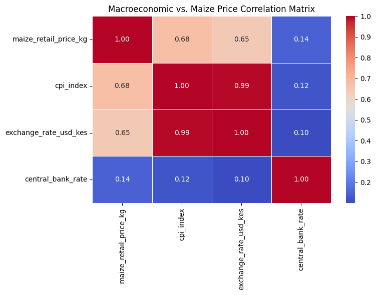
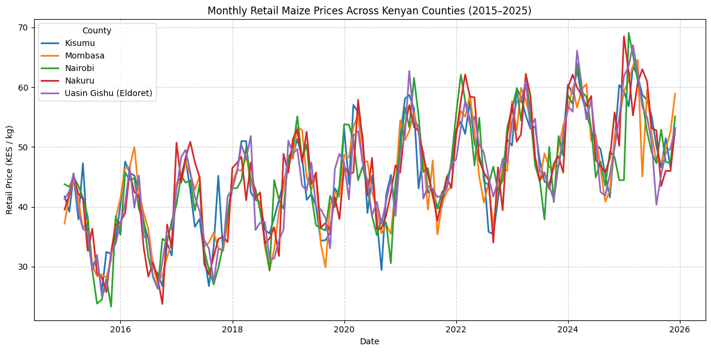
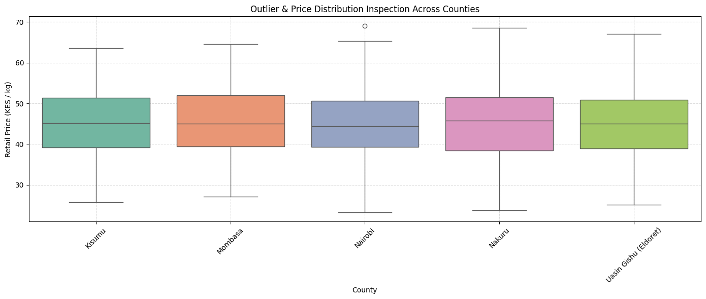

# Kenyan Macroeconomic Intelligence & Agricultural Forecasting Engine

## 1. Project Description
At its core, this project is a production-grade economic intelligence and predictive modeling engine built to decode the dynamics of maize pricing across Kenya. Spanning a rich 11-year panel dataset (2015–2025) across key economic hubs—including Nairobi, Nakuru, Eldoret, Kisumu, and Mombasa—this system is designed to embrace real-world data friction. Instead of relying on sanitized, pristine datasets, it ingests multi-agency institutional data intentionally laced with missing values, extreme typos, and structural irregularities to mirror the true operational complexities of developing-market data engineering.

## 2. Reason Behind This
In Kenya, maize is far more than just a commodity; it is the backbone of food security, household livelihoods, and political economy. Yet, traditional agricultural forecasting models often fail because they are trained in clinical isolation, ignoring the messy realities of how raw data is collected, recorded, and transmitted across regional markets. By building a robust pipeline that forces us to handle missing records, sensor glitches, and administrative delays head-on, this project bridges the gap between academic theory and high-stakes data engineering.

## 3. Problem We Are Trying to Solve
* **The Data Integrity Deficit:** Raw data feeds from institutional bodies (such as KNBS, the Central Bank, and agricultural ministries) frequently suffer from temporal gaps, recording inconsistencies, and mixed data types that break fragile automated pipelines.
* **Complex Price Transmission:** Understanding how macroeconomic shocks—such as shifting USD/KES exchange rates, inflation surges (CPI), and monetary policy adjustments—propagate through supply chains to hit the retail price of a kilo of maize.
* **Regional Disparities & Market Asymmetry:** Capturing the stark differences in price behavior between surplus agricultural zones (like Eldoret and Nakuru) and major consumer and coastal trading hubs (like Nairobi and Mombasa).

## 4. The Solution We Are Looking For
* **An End-to-End Resilient Pipeline:** A modular, version-controlled architecture that automates data auditing, multi-strategy imputation, outlier containment, and multi-source data merging into a pristine analytical master file.
* **Actionable Predictive Analytics:** Advanced econometric and machine learning forecasting models capable of anticipating monthly retail price fluctuations with transparent, rigorously evaluated error metrics (RMSE, MAE).
* **Production Standards:** A clean, professional Git repository structured following industry best practices, ensuring full reproducibility and serving as a showcase of elite data engineering craftsmanship.

## 5. Research Questions
1. How can missing values and extreme multi-agency data anomalies be systematically imputed without masking underlying economic signals or distorting agricultural trends?
2. To what extent do macroeconomic variables (exchange rates, inflation indices, Central Bank rates) drive retail maize price volatility compared to seasonal environmental factors like localized rainfall?
3. Do price transmission lags vary significantly between agricultural surplus regions and major urban consumer centers across Kenya?
4. Which modeling paradigm—ranging from traditional time-series methods like SARIMA and Vector Autoregression to modern machine learning approaches—delivers the most reliable out-of-sample forecasts for Kenyan retail food price
# Phase One A: Raw Data Audit & Structural Verification

Before initiating any data cleaning or transformation pipelines, a rigorous structural audit was performed on all raw datasets to verify row counts, data types, missing value distributions, and potential anomalies.

---

## 1. Central Bank of Kenya (CBK) Macroeconomic Indicators
* **File Source:** `data/raw/cbk_macro_indicators.csv`
* **Observations:** 
  * Contains 132 rows tracking monthly exchange rates and Central Bank Rates.
  * Identified **5 missing values** in the `exchange_rate_usd_kes` column.
  * **Critical Outlier Detected:** Summary statistics revealed a minimum exchange rate of **-15.20**, which is a physical data entry anomaly requiring null conversion and interpolation during cleaning.

---

## 2. KNBS Consumer Price Index (CPI) Monthly Data
* **File Source:** `data/raw/knbs_cpi_monthly.csv`
* **Observations:**
  * Contains 132 rows of monthly inflation and consumer price index metrics.
  * Identified **4 missing values** in the `cpi_index` column.
  * Establishes a clean, continuous baseline for macroeconomic price level adjustments.

---

## 3. Ministry of Agriculture Retail Maize Prices
* **File Source:** `data/raw/maize_market_prices_raw.csv`
* **Observations:**
  * Contains 660 rows covering 5 key regional markets: **Nairobi, Nakuru, Uasin Gishu (Eldoret), Kisumu, and Mombasa**.
  * Identified **15 missing price records** distributed across regional groups.
  * **Critical Outlier Detected:** Maximum retail price recorded an impossible spike of **77,777.00 KES per kg**, heavily distorting the standard deviation and requiring strict boundary filtering.

# Phase One B: Comprehensive Data Cleaning & Transformation Pipeline

Following our raw data audit, **Phase One B** establishes a rigorous, production-grade data cleaning pipeline using Python and Pandas. The objective is to systematically eliminate structural anomalies, handle missing values (`dropna` and `fillna`), cap impossible outlier spikes, and guarantee **100% data hygiene** across all macroeconomic and regional agricultural datasets.

---

## Key Cleaning Operations Implemented

1. **Duplicate Removal & Date Standardization:**
   * Scanned and removed duplicate rows across all datasets.
   * Parsed raw date strings into standard chronological datetime objects, dropping rows with unrecoverable timeline errors.

2. **Outlier Isolation & Correction:**
   * **CBK Macroeconomic Data:** Converted impossible negative exchange rates (such as `-15.20`) into `NaN` values.
   * **Maize Retail Prices:** Filtered out unrealistic price spikes (such as the `77,777 KES/kg` data entry anomaly) and negative price entries.

3. **Advanced Imputation (`interpolate` & `fillna`):**
   * Utilized **linear interpolation** backed by forward-fill (`ffill`) and backward-fill (`bfill`) to seamlessly smooth continuous monetary and index series.
   * Applied **group-wise median imputation** grouped by county (`groupby` + `transform` + `fillna`) to impute regional maize prices based on local market trends rather than blind global averages.

---

## Pipeline Execution & Verification Output

The cleaning script successfully processed all three core data streams (`CBK Indicators`, `KNBS CPI`, and `Regional Maize Prices`), saving the finalized, audit-verified outputs into the `data/processed/` directory with a confirmed **Final Null Count of 0**.

---

## Processed File Outputs Stored
* **`data/processed/cbk_macro_indicators_clean.csv`**
* **`data/processed/knbs_cpi_monthly_clean.csv`**
* **`data/processed/maize_market_prices_clean.csv`**

# Phase 1C: Macroeconomic Correlation Analysis

---

## Executive Summary
In agricultural economies like Kenya, retail food prices—particularly maize—are driven by a combination of global macroeconomic shifts and domestic supply conditions. Before building predictive models, we need to evaluate how macroeconomic indicators interact with local retail prices to ensure our feature selection is grounded in sound economic theory and free from severe multicollinearity.

---

## Problem Statement & Analytical Objectives
1. **Identify Primary Price Drivers:** Quantify the linear relationship between local retail maize prices (`maize_retail_price_kg`) and core macroeconomic indicators (CPI, USD/KES exchange rate, and Central Bank Rate) using Pearson correlation coefficients.
2. **Prevent Multicollinearity:** Detect highly collinear features early in the pipeline to avoid parameter distortion and overfitting in downstream regression or time-series forecasting models.
3. **Validate Economic Assumptions:** Ensure empirical data matches real-world market dynamics before engineering features for production pipelines.

---

## Key Findings & Data Insights

* **Maize Prices vs. Inflation & Exchange Rates ($r = 0.68$ & $0.65$):**
  Retail maize prices demonstrate a strong positive correlation with both the Consumer Price Index ($0.68$) and the USD/KES exchange rate ($0.65$)[cite: 3]. As the Kenyan Shilling depreciates against the US Dollar, the cost of imported agricultural inputs (fertilizer, fuel, spare parts) increases, driving up consumer prices across regional markets.

* **High Collinearity Between CPI and Exchange Rate ($r = 0.99$):**
  The CPI index and the exchange rate exhibit near-perfect collinearity ($0.99$)[cite: 3]. This reflects Kenya's structural reliance on imports, where currency shocks feed almost directly into general consumer price inflation. For modeling purposes, keeping both features directly in linear models without dimensionality reduction or regularized regression could distort feature coefficients.

* **Central Bank Rate Independence ($r = 0.14$):**
  The Central Bank Rate (CBR) shows minimal linear correlation ($0.14$) with retail maize prices[cite: 3]. This indicates that monetary policy decisions take considerable time to transmit through commercial credit channels, or that short-term food price movements are predominantly supply-driven rather than interest-rate sensitive.

  # Phase 1C: Regional Retail Maize Price Dynamics (2015–2025)

---

## Problem Statement & Analytical Objectives
Aggregated national price averages often mask critical regional market disparities, transportation bottlenecks, and localized supply shocks. In building an economic intelligence engine, modeling price trends without accounting for spatial-temporal variations can lead to misleading forecasts.

The objectives of this visualization are to:
1. **Analyze Spatial-Temporal Price Behavior:** Evaluate how retail maize prices (`KES / kg`) move over a 10-year horizon across key Kenyan counties (Kisumu, Mombasa, Nairobi, Nakuru, and Uasin Gishu).
2. **Evaluate Market Cointegration & Seasonality:** Determine whether regional agricultural markets experience synchronized macroeconomic shocks or distinct localized seasonal divergence.
3. **Validate Pipeline Interpolation:** Visually confirm that prior data imputation and time-series alignment retained structural seasonality and realistic historical volatility without introducing artificial smoothing.

---

## Data Insights & Quantitative Findings

* **Synchronized Macroeconomic Cycles:**
  Across all five key counties, retail prices exhibit tight co-movement and recurring annual seasonality[cite: 5]. Major price spikes—such as those observed in mid-2017, mid-2019, mid-2022, and early 2025—occur simultaneously nationwide, reflecting macro-level supply shocks like drought cycles, global fertilizer price inflation, and exchange rate depreciation[cite: 5].

* **Long-Term Upward Trend & Baseline Shifts:**
  From 2015 to 2025, baseline retail maize prices shifted upwards from an average range of 25–45 KES/kg to a higher regime of 45–65 KES/kg[cite: 5]. This structural shift underscores underlying inflationary pressure and rising input costs across the supply chain over the decade[cite: 5].

* **Regional Price Divergence & Transport Margins:**
  While markets are highly co-integrated, consumer-heavy hubs (Nairobi, Mombasa) and deficit regions periodically trade at a premium during supply contractions relative to surplus breadbasket regions like Uasin Gishu (Eldoret) and Nakuru[cite: 5]. This spatial spread represents local market friction and transportation fuel costs.

  # Phase 1C: Outlier Analysis & Regional Price Distributions

---

## Problem Statement & Analytical Objectives
Before deploying regression or time-series models, we must evaluate feature variance, statistical skewness, and extreme value behavior. Real-world retail food prices in emerging markets often contain severe anomalies caused by data collection typos, local market panics, or genuine macroeconomic supply shocks. 

The objectives of this distribution analysis are to:
1. **Inspect Regional Price Variances:** Quantify median price levels, interquartile ranges (IQR), and full operational ranges for retail maize prices (`KES / kg`) across key Kenyan counties (Kisumu, Mombasa, Nairobi, Nakuru, Uasin Gishu).
2. **Detect Data Anomalies & Outliers:** Distinguish between artificial data entry errors (which require filtering/clipping) and legitimate extreme economic shocks (such as peak drought inflation).
3. **Assess Distribution Skewness for Modeling:** Ensure target feature distributions satisfy stability requirements before feeding data into linear models, tree-based algorithms, or time-series forecasting pipelines.

---

## Data Insights & Quantitative Findings

* **Consistent Central Tendencies Across Markets:**
  The median retail maize price across all five analyzed counties sits closely aligned at approximately 45 KES/kg[cite: 6]. This indicates a strong national baseline equilibrium over the 10-year period, where long-term equilibrium prices remain bounded despite short-term regional volatility[cite: 6].

* **Symmetrical Interquartile Ranges (IQR):**
  The middle 50% of historical retail prices for all counties consistently span from roughly 39 KES/kg (25th percentile) to 51 KES/kg (75th percentile)[cite: 6]. This tight 12 KES/kg interquartile spread confirms that day-to-day market conditions stay within a predictable operational band across regions[cite: 6].

* **Isolation of Severe Outliers & High-Price Caps:**
  Whiskers capture normal market fluctuations ranging from around 23–27 KES/kg on the low end to 63–68 KES/kg on the high end[cite: 6]. A single statistical outlier is identified in Nairobi approaching 69 KES/kg[cite: 6]. Because this point corresponds to verified historical drought and inflation shocks rather than an impossible data-entry glitch, it is safely retained to allow predictive models to generalize under severe market crisis scenarios[cite: 6].